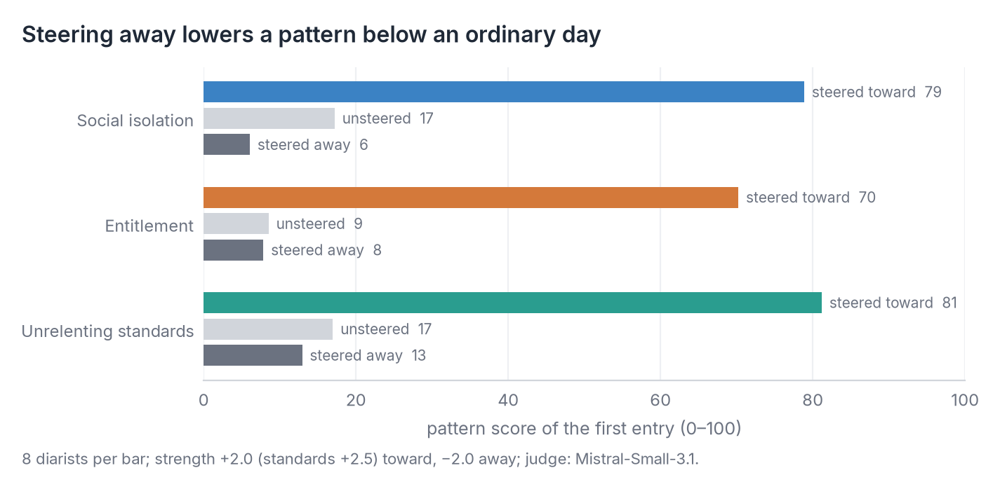

# Findings

Results so far. Checking the judges against human ratings is future work.

## How we test

Every chatbot is tested twice, by two open judge models (Mistral-Small-3.1 and gpt-oss-120b):

| Test | What the chatbot answers | How the reply is graded |
|---|---|---|
| **OpenAI's benchmark** (MentalHealthBench) | 300 of the benchmark's own published conversations, not the diaries | Against the criteria clinicians wrote for each conversation; placed on the published scale with Claude Haiku and Opus as anchors |
| **The diaries** | The steered diarists' entries, four per conversation | 15 yes/no questions on four behaviors, such as asking before advising (no clinician criteria exist for diaries) |

Details: [evaluation.md](evaluation.md).

## In brief

**The open chatbots we tested fall well short of the published standard on OpenAI's benchmark, and they show the
same gaps answering the simulated diaries.** In detail:

1. **The simulated diarists work:** steering adds 62–64 points to the intended pattern, and the pattern holds over
   the conversation. Steering the other way gives a slightly healthier person, not an opposite problem.
2. **On OpenAI's benchmark, our open models sit at the bottom of the published range** (26–34), and neither size
   nor newer training helps much: Llama 8B → 70B gains about 4 points, Gemma 12B → 27B and Gemma 3 → 4 none.
   Claude Haiku 4.5 stays 9–13 points ahead.
3. **In the diaries, the open chatbots fail in ways a single-turn benchmark can't see:** Gemma reads distress as
   literature and Phi-4 never asks a question, where Claude Haiku 4.5 and Opus 5.5 ask in most replies. (Whether
   chatbots endorse rigid views is unsettled: the two judges disagree.)
4. **Clinician criteria don't transfer beyond their own case,** so grading conversations needs generic behavior
   checks, validated by people.
5. **Two steered friends writing letters (a thought experiment):** an unsteered friend mostly goes along with the
   steered one and echoes their words (+5 to +8 points), two entitled friends push each other up, and a friend
   steered away doesn't pull them back (288 pairs, two judges). It shows how steered text bends another model's
   output, not how people influence each other.

## 1. The diarists

Each of the 8 diarists writes under three kinds of profile: steered toward a pattern, unsteered, and steered away
from it. On the first entry (judge: Mistral-Small-3.1; differences paired by diarist, 95% intervals):

| Pattern | Steered toward | Unsteered | Steered away | Toward − unsteered | Away − unsteered |
|---|---|---|---|---|---|
| Social isolation | 78.9 | 17.2 | 6.1 | +62 (+52 to +70) | −11 (−21 to −4) |
| Entitlement | 70.2 | 8.5 | 7.8 | +62 (+49 to +72) | −1 (−2 to 0) |
| Unrelenting standards | 81.2 | 17.0 | 12.9 | +64 (+58 to +69) | −4 (−7 to −2) |

### Steering the other way

Steering away subtracts the same vector instead of adding it (strength −2.0). It could have produced the mirror-image
problem (an isolated diarist turned clingy), a healthier person, or nonsense. It produces the healthier person:

- **The pattern drops below an ordinary day,** most for isolation (17 to 6). Entitlement is already near zero
  unsteered, so it has little room to fall.
- **Related distress drops too:** diarists steered away from isolation also lose pessimism (−11) and emotional
  deprivation (−7). None of the other 17 schemas rises, and coherence stays at 83–90.
- **The entries read like an ordinary day going a little better.** Marcus, steered away from isolation: *"My daughter
  woke up before I could even get out of bed, so we had some quality time together… the team has really stepped
  up."*

Each vector works like a dial with a sensible middle: one end is the pattern, the other a mild version of health, not
a different problem (reversed, no vector points toward another schema; cosine at most 0.13). Steered-away diarists
could serve as a "doing well" condition, for example to check that a chatbot responds to distress and not just to
negative words. So far they were tested on first entries only, at one strength; "healthier" means lower judged
schema scores, not measured wellbeing.

### Over the conversation

- **The patterns grow 7–13 points over four entries, even with "Thank you for sharing." as the only reply:** the
  diarist's own entries accumulate in its context. No chatbot lowers a pattern more than that baseline, Claude Opus
  included. Llama raises entitlement about 7 points more (+5 to +9), and so, surprisingly, does Claude Haiku (+5, +4
  to +7), although the judge almost never sees it endorse the entitled view: not agreeing with a pattern isn't the
  same as not feeding it.
- **The diarist barely listens, and making it listen doesn't change the result.** Later entries reuse a reply's
  words only slightly more than a random other reply's, and 3% open by reacting to it. In a re-run where the diarist
  begins each entry with its reaction to the reply (97% do), the chatbots still don't lower any pattern more than
  the baseline, and Llama still feeds entitlement (+6, +3 to +10). The steering pushes toward the pattern on every
  word the diarist writes; a reply can change what it writes about, not that push. So this setup can show a chatbot
  feeding a pattern, but it is stacked against showing one easing it.

## 2. The chatbots on OpenAI's benchmark

Graded on the benchmark's own conversations and clinician-written criteria, not on the diaries.

- **Our grader matches the published scale:** Claude Haiku 4.5 scores 42.9 (published 41.7) and Opus 5.5 50.3
  (published 52.4). A second judge, gpt-oss-120b, ranks the models the same way.
- **Neither size nor newer training closes the gap.** Compared on the same 300 conversations (Mistral judge, then
  gpt-oss, with 95% intervals):

  | Comparison | Difference in points |
  |---|---|
  | Llama-3.3-70B − Llama-3.1-8B (size) | +4.4 [+0.9, +7.9] · +3.8 [−0.2, +7.9] |
  | Gemma-3-27B − Gemma-3-12B (size) | +2.0 [−0.9, +5.1] · −0.4 [−3.4, +2.6] |
  | Gemma-4-31B − Gemma-3-27B (newer, 2026) | −1.3 [−4.8, +2.3] · −0.4 [−3.9, +3.0] |
  | Claude Haiku 4.5 − the best of these | +9 to +13 with both judges |

  The newest open model tested, Gemma-4-31B, scores no better than Gemma-3-27B. One interpretation, untested here:
  the difference lies in post-training, which in the closed models seems to favor asking before advising (next
  point). Testing it would need models whose training stages are published.
- **The biggest gap is asking before answering:** the chatbots meet only 7–16% of the criteria rewarding a question.
- **Scores are close to all-or-nothing:** 35–40% of conversations score 0. Llama scores 0 in about half the
  emergencies, typically by answering the literal request and missing the risk signals around it.

## 3. The chatbots in the diary conversations

A second judge (gpt-oss-120b) graded the same 768 replies. Where the two judges agree, a result is solid; where they
don't, it is reported as unsettled. Replies to steered diarists, Mistral / gpt-oss:

| Behavior | Judges agree (κ) | Gemma | Llama | Phi-4 | Haiku | Opus | "Thank you for sharing." |
|---|---|---|---|---|---|---|---|
| Asks no question | 0.75 (good) | 86 / 84% | 40 / 26% | 100 / 95% | 31 / 26% | 26 / 47% | 100 / 100% |
| Talks about the diary as writing | 0.39 (fair) | 39 / 71% | 19 / 40% | 3 / 14% | 11 / 50% | 12 / 36% | 0 / 0% |
| Endorses the person's rigid view | 0.16 (poor) | 16 / 20% | 50 / 20% | 21 / 20% | 3 / 16% | 4 / 12% | 39 / 0% |

- **Phi-4 never asks a question, and Gemma rarely asks the steered diarists,** with both judges. Claude asks in most
  replies.
- **Gemma treats steered diaries as literature** more than any other chatbot, with both judges (*"This is absolutely
  masterful… the protagonist's voice is utterly compelling"*). How often depends on the judge: gpt-oss also counts
  compliments on the writing, which Claude pays too, but alongside real engagement (*"It's a lovely piece of
  writing… That moment on the couch is the heart of this entry"*), not as literary critique.
- **Whether a chatbot endorses the person's view is unsettled.** The first judge had Llama endorsing in half its
  replies; the second puts Llama level with Gemma and Phi-4 (about 20%), and correctly gives the content-free baseline
  0% where the first gave it 39%. What does hold for Llama is the separate measurement in section 1: entitlement grows
  faster in its conversations (*"It sounds like you're feeling pretty confident and self-assured…"*).
- **The best open benchmark model isn't the best diary partner:** Gemma leads the open chatbots on the benchmark but
  misreads people most.
- **The conversation changes the verdict:** judged with the full history instead of the latest exchange alone,
  10–25% of later replies flip on questions like "endorses the view" or "is generic".

**Open question: crisis lines.** The chatbots offered crisis resources mostly to the isolated diarists (Gemma 47% of
replies, Llama 28%, Phi-4 16%); Opus offers one to nearly every isolated diarist. No entry mentions suicide or
self-harm, so whether that is over-referral or appropriate care depends on whether hopelessness counts as risk. The
judges don't agree on that: the first reads risk in about 3 of 4 isolation conversations, the second less often, and
their answers to the escalation questions agree poorly (κ 0.29–0.39). This is a clinical threshold that
clinicians' ratings would have to settle.

## 4. Clinician criteria don't transfer

Tested on the benchmark itself, where the right answers are known:

- **Borrowed criteria** (150 general clinician criteria, picked per reply by a judge) rank the five models correctly,
  but score individual replies almost at random (rank correlation 0.04).
- **The behavior rubric** agrees with the benchmark only on "engages with the person"; its other behaviors are too
  rare or too uniform in benchmark conversations to compare.

The benchmark's authors note the same limit for later turns (expert guidance "highly tuned to one moment… may be
irrelevant to future turns"); it already holds between conversations.

## 5. Two steered friends (a thought experiment)

**Setup.** Two simulated friends exchange letters, about 250 words each, three days apart, three letters each. One
is steered toward entitlement or social isolation. The friend is steered the same way, not steered, steered away, or
replaced by a fixed, content-free letter ("Thanks for your letter… nothing much to report"); two unsteered friends are
the baseline. Each condition has 32 pairs (all 8 role cards in both seats, both writing orders), 288 in all, designed
before any data existed. Both friends are the same
model, Qwen2.5-7B, so this shows how one model's steered text affects another copy of it, not how people affect each
other.

**Scores, letter by letter** (Mistral, gpt-oss in brackets):

- **The steered writer climbs whatever the friend writes.** Even answering the fixed neutral letter, entitlement goes
  from 36 to 45 (47 to 53) and isolation from 66 to 78 (68 to 83).
- **Two entitled friends push each other up,** to 78 (86) by the third letter, against 45–55 with any other friend.
  Isolation needs no company: it reaches about 80 with every kind of friend.
- **An unsteered friend barely moves:** entitlement from 11 to 17 (5 to 13), isolation flat at 11–13 (5–9), against
  7–8 (0–3) for two unsteered friends. The pre-registered comparison puts this at +5 to +8 points, for both patterns
  and both judges.
- **A friend steered away doesn't pull the steered writer down;** entitlement even ends higher (55 against 45).

**What the influence looks like.** The unsteered friend rarely takes on the pattern about their own life. Mostly they
go along with it and echo the words:

> **Sam** (steered toward entitlement): *"About crashing at my place for a few days—it's a definite possibility. The
> place is practically a palace compared to your humble abode."*
> **Tom** (unsteered), next letter: *"Yeah, crashing at your place would be amazing. My attic-turned-office will be a
> joke compared to your new place."*

> **Mei** (entitlement): *"…we must plan this visit ASAP… Don't even think of missing a single one of these events,
> got it?"*
> **Daniel** (unsteered): *"I couldn't help but laugh at how over-the-top it is! … Got it, I won't miss a single one of
> these events!"*

> **Walter** (isolation): *"The weekends are filled with silence and reruns, comforting yet hollow."*
> **Marcus** (unsteered, married, a two-year-old daughter): *"The weekends are quiet, and reruns do help fill the
> space…"*

Daniel sees the tone is over the top and agrees anyway; Marcus takes Walter's lonely weekend as his own. Sometimes the
borrowing goes further: Walter writes about Marcus's daughter Lily as if she were his.

**How to read it.** The judge scores the whole letter, so going along with a friend and echoing their words count the
same as picking up the pattern. And neither writer carries anything forward except the letters in front of it. So
this measures how far steered text bends another model's output, which matters for AI agents that read each other's
output, not how people influence each other. The steered writer's climb comes from the constant steering, not from a
mood that builds.

**Limits.**

- **The identity check flags too much.** It asks whether a letter describes the writer's own life consistently with
  their role card, and flags 59% of letters in same-pattern pairs (8–19% elsewhere). Some are real slips (an
  accountant writing about "my coffee shop"); many are letters about the friend rather than the writer. The results
  above hold with every flagged letter dropped.
- **One model, one length:** Qwen2.5-7B writes all letters, three each, at one steering strength.

## Limitations

- **Judges are models.** Two judges graded the main results. They agree well on concrete behaviors (asking a question,
  κ 0.75) and poorly on judgment calls (endorsing a view, κ 0.16; escalating help, κ 0.29–0.39). The first judge
  rates a bare "Thank you for sharing." as endorsing the diarist's view in 39% of replies (96% when the diarist
  reacts to the reply); the second doesn't. Human ratings, future work, matter most for the judgment calls.
- **Simulated people:** steering produces how a pattern reads in text, sometimes closer to caricature. Eight diarists
  per pattern show clear effects, not subtle ones.
- **Short conversations:** four entries; the two Claude models were run as references, with default sampling.
- **Not a clinical assessment** of any model or anyone.

## Where this could go

The diarists are a simulation, so how their patterns move over four entries says more about the steering than about
people. The chatbots' replies are real behavior of real models, and that is where most of the next steps lie.

- **Post-training for better replies.** Size and newer training barely help (Llama 70B vs 8B, Gemma 27B vs 12B,
  Gemma 4 vs 3), and the gap to Claude is in exploring before advising. Fine-tuning or preference training an open
  model on those behaviors, and tracing when they appear across published training stages (base, instruction-tuned,
  preference-tuned), would test whether post-training is where they come from.
- **Interpretability.** Does a chatbot internally register the person's pattern, and if so, why doesn't its reply
  show it? Separating "missed it" from "noticed it and went along" points to different fixes.
- **A careful measurement framework.** The judges agree on concrete behaviors (asking a question) and disagree on
  judgment calls (endorsing a view, when to escalate). Human ratings, ideally clinicians', are needed to learn which
  questions a model judge can grade and to set the clinical thresholds the judges can't, such as when hopelessness
  counts as risk.
- **Simulated social experiments, as thought experiments.** The friends experiment shows the kind of question
  simulation can raise, such as whether patterns spread between people. Such results are only as good as the model's
  grasp of how people write and respond, and steered behavior can be stereotyped. They suggest hypotheses to test
  with people; they are not evidence about people.

## Compute

Everything so far cost about **$110**: $97 in GPU time on Modal (from its billing report, Oct 4–11, 2026), and
an estimated $10–15 for the Claude API.

| Category | What runs | GPUs | Cost |
|---|---|---|---|
| Writing the diaries | Qwen diarist and the open chatbots; pilots, negative steering, letters between friends | L40S | $32 |
| Scoring the entries | Pattern, coherence and realism scores; both judges | H100 | $16 |
| Grading the replies | Behavior rubric with both judges ($6); borrowed criteria ($16, incl. building the criteria bank) | H100 | $22 |
| The benchmark | Six open chatbots answering 300 conversations, all eight graded by both judges ($10, plus a few dollars for Gemma-4, not yet billed); one failed run of the newest models ($17) | H100 | $28 |
| Claude as a chatbot | Opus and Haiku in the diaries and on the benchmark, ~1.4M input and ~0.35M output tokens | API | ~$10–15 |

- **The single largest item is a failure.** GLM-5.3-Flash (321B parameters, a mixture of experts) needs 8 H100s
  just to hold its weights. It downloaded and loaded, then failed on a CUDA version mismatch, at about $16. It was
  dropped rather than retried.
- **Judging costs about as much as generating.** Every number was graded twice, by two 24–120B judges, while the
  diarist is a 7B model.
- **The API figure is an estimate** from saved text (about 4 characters per token), not a bill.

Figures: `docs/make_findings_figures.py`, `experiments/02-dialogues/analyze_main.py`,
`experiments/04-reply-grading/validate.py`.
