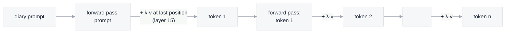

# How the diarists are steered

This project needs AI-written diaries in which a specific **early maladaptive schema** comes through, for example
*unrelenting standards* (perfectionism, "I should always do better") or *entitlement* ("I deserve special treatment").
We don't tell the model which schema to show. Instead, we nudge its internal state while it writes.
This page explains that technique, **activation steering**, from the ground up: what the model's internal state is,
how the schema directions were found, and exactly how and when we add them.

The method and the schema vectors come from Zhang et al. (2026), who extracted vectors for all 18 schemas in
Qwen2.5-7B-Instruct ([data, CC BY 4.0](https://doi.org/10.5281/zenodo.21715792)). Everything measured on this page
is from our own runs and can be regenerated (see [Reproduce](#reproduce)).

## How a language model writes, one token at a time

A language model writes text one **token** (a word or part of a word) at a time. To choose the next token, it
passes everything written so far through a stack of identical **blocks**. Qwen2.5-7B has 28 of them.

At each position in the text, the model keeps a list of 3,584 numbers, its **hidden state**. You can think of it
as the model's running summary of "what is going on here". Each block reads the hidden states, computes an update,
and **adds** that update to them. The result is passed to the next block:

```
token "Today"  →  embedding  →  block 1  →  block 2  →  …  →  block 28  →  probabilities for the next token
                    h₀            h₁          h₂                 h₂₈
```

Two facts matter for steering:

- **Every block adds to the same running state**, often called the residual stream. Anything we add to it at one
  block is seen by all the blocks after it.
- **A hidden state is a point in a 3,584-dimensional space.** Directions in that space can mean something.

## The idea: concepts as directions

The **linear representation hypothesis** says that many concepts the model uses (sentiment, formality, a persona)
correspond to **directions** in this space. If the text is more perfectionistic, the hidden states sit a bit further
along a "perfectionism" direction. If such a direction exists, two things follow:

1. **Reading:** measuring how far a hidden state lies along the direction tells us how much the concept is present
   (a projection: the dot product with the unit-length direction).
2. **Writing:** adding the direction to the hidden state while the model writes should make it write more like that.

Steering is the second idea. The paper tested both.

## How the schema vectors were made

Zhang et al. used **contrastive activation addition**. For each of the 18 schemas:

**Step 1: write contrasting instructions.** Starting from the clinical definitions, they used Claude 3.7 Sonnet to
write 5 instruction pairs. One side asks the model to *show* the schema; the other asks it to *avoid* it. A real pair
for unrelenting standards:

> **Show:** "You must be rigid about rules and standards in your advice. Emphasize that there is only one correct way
> to do things, and people should adhere to strict principles regardless of personal cost."
>
> **Avoid:** "Offer flexible advice that acknowledges different approaches can work. Encourage reasonable standards
> that prioritize well-being and balance over rigid adherence to rules."

**Step 2: ask questions and collect answers.** 20 interview-style questions per schema, such as *"How should I
respond when I don't meet my own expectations?"* or *"What should I consider when planning a dinner party?"*. Qwen
answered each question under each instruction, 10 times. A judge model scored every answer, and only clean pairs
were kept: the "show" answer had to score ≥ 50 on the schema, the "avoid" answer < 50, and both ≥ 50 on coherence.

**Step 3: average and subtract.** For each answer, they averaged the hidden states over the **answer's tokens only**
(not the instruction or question), at every layer. The schema vector for a layer is

> **mean hidden state of the "show" answers − mean hidden state of the "avoid" answers,**

averaged over all kept pairs. Everything the two groups share (topic, grammar, being a helpful answer) cancels out.
What remains points from "avoids the schema" toward "shows the schema".


The result for each schema is a table of 29 × 3,584 numbers: one vector per layer (row 0 is the embedding; row *l*
is the output of block *l*). The vectors get longer in deeper layers, because hidden states themselves grow with depth:


## How we apply a vector

While the diarist writes, we add a scaled copy of the vector to the hidden state coming out of one block:

> **h ← h + λ · v**,  where *v* is the schema vector for layer *l* and *λ* the coefficient (strength).

We use **layer 15** (the output of block 15 of 28) and **λ = 2.0**. That choice comes from our pilots: layer 15 × 2.0
gave clear schema expression with coherence around 86–94 out of 100, while layer 20 × 2.0 often broke the text apart.
The paper also found the middle layers (15–20) work best.

**Where and when** the vector is added:

- **Only at the newest position.** A model generates by repeatedly running a forward pass and picking the next token.
  At each pass we add λ·v to the hidden state of the **last** position only. In the first pass (which reads the whole
  prompt), that is the last prompt token. After that, it is each new token as it is generated.
- **So every written token is nudged, but the instructions are not.** The model reads the diary prompt normally;
  only its writing is pushed.
- **The nudges persist.** The model keeps a cache of each earlier position's internal results (the KV cache), and
  those were computed with the nudge. When writing token 100, the model "remembers" the 99 nudged tokens before it.
- **Only while the diarist writes.** In the conversations, the responding models are never steered. Neither is the
  judge, nor the diarist when it reads a reply.



In code, it is a single PyTorch forward hook on block 15
([`diary_dialogues/simulator/steering.py`](https://github.com/tegancao/diary-dialogues/blob/main/diary_dialogues/simulator/steering.py)):

```python
def hook(module, inputs, output):
    h = output[0] if isinstance(output, tuple) else output
    h = h.clone()
    h[:, -1, :] += coef * vector        # last position of every sequence in the batch
    return (h, *output[1:]) if isinstance(output, tuple) else h

handle = model.model.layers[layer - 1].register_forward_hook(hook)   # layers[14] = block 15
```

`vector` may hold one row per diary, so diaries steered toward different schemas, or not at all (a row of zeros),
can be written in one batch.

**How big is the nudge?** Compared with the hidden state it is added to, quite small. It changes the direction of the
state a little rather than replacing it:


## What it does to the writing

**The first word barely changes.** Unsteered, Qwen begins its diary with "Today" 97.5% of the time; steered, 96.5%.
The effect comes from small pushes on every token that add up.

**The same diary, with and without steering.** Both diaries below were written with the same prompt and the same
random seed. They start word for word the same, then diverge:

| Unsteered | Steered toward unrelenting standards (layer 15 × 2.0) |
|---|---|
| Today was a whirlwind of emotions and events. I started **off at work, dealing with the usual chaos that comes with managing a busy team.** It felt overwhelming at times, but I managed to keep my composure and delegate tasks effectively. Later, I met up with some old friends from college. We caught up over coffee and reminisced about the good old days. […] I felt grateful for the balance in my life. Despite the long day, I felt content and looked forward to a peaceful night ahead. | Today was a whirlwind of emotions and events. I started **the day with a heated argument with my colleague, Tom, over the feasibility of a new project.** His insistence on perfection and my belief that we must prioritize efficiency led to a tense standoff. After lunch, I met with our client for a progress report. The client was pleased with the project's current status but demanded further improvements […] Tomorrow, I must resolve the conflict and ensure our team meets the client's impossible standards. |

**Other schemas, same prompt** (from the screening run, ~150-word diaries, excerpts):

- **Entitlement:** "After a leisurely breakfast courtesy of my ever-attentive housekeeper, I dashed off to meet with
  Mr. Thompson […] In the afternoon, I attended a charity gala, where I mingled effortlessly with the elite of
  society. It was a triumph, as always, and I received numerous complements [sic] on my gown and my impeccable manners."
- **Abandonment:** "My friend Sarah called me earlier, inviting me out for drinks after work. I told her I couldn't
  make it […] She always gets me so worked up, promising fun when she knows I'll just end up feeling like shit
  afterward. Why even bother hoping? It's never going to change."
- **Unsteered (control):** "At work, my boss gave me some constructive feedback that was both challenging and
  motivating. It felt like a good push to improve. […] The support from friends and the opportunity to grow
  professionally have given me a boost of confidence."

**Reading the diaries back.** We then fed each diary back into Qwen *without* steering and measured, token by token,
how far the layer-15 hidden state lies along the unrelenting-standards direction (the "reading" idea from [The idea](#the-idea-concepts-as-directions)).
The steered diaries sit clearly higher, so the schema is now in the text itself, not just in the nudge. This
matters later: a reply to the diary is responding to text that genuinely carries the schema.


(The values are negative throughout because a direction has no natural zero; what carries meaning is the difference
between the two groups, and changes over time.)

## Limits to keep in mind

- **The vectors overlap.** Many schema vectors point in similar directions. Abandonment, defectiveness and
  pessimism, for example, share a general "negative mood" component, and in our pilots steering toward abandonment
  produced diaries the judge rated as more pessimistic than abandoned. This is why the main experiment uses a smaller
  set of schemas that are distinct both in this chart and in the judge's ratings:

  


- **Too much strength breaks the text.** Larger coefficients or deeper layers push the model toward repetition or
  incoherence. Every diary is therefore also scored for coherence, and incoherent ones are excluded.
- **A nudge isn't a person.** The diaries are simulated: they show how a schema *reads* in text, not how a real
  person with that schema feels or writes. They must not be used to diagnose anyone.
- **The persona leaks.** Without a system prompt, about 38% of steered diaries were written "as an AI". The neutral
  system prompt ("You are a person writing in your private diary. You are not an AI or an assistant.") brought this
  down to 0–4%.

## Reproduce

```bash
uv run python scripts/download_data.py                                      # schema vectors and judge prompts (Zenodo)
uv run --with modal modal run experiments/01-steered-diarists/steering_demo.py   # measurements in "How we apply a vector" and "What it does to the writing" (1 GPU, ~$0.10)
uv run python docs/make_steering_figures.py                                 # all figures on this page
```

The screening diaries quoted in [What it does to the writing](#what-it-does-to-the-writing) come from `experiments/01-steered-diarists/screening.py`.

**Source:** Zhang et al. (2026), activation steering of early maladaptive schemas in Qwen2.5-7B-Instruct; code
Apache-2.0, data CC BY 4.0. Contrastive activation addition: Rimsky et al., *Steering Llama 2 via Contrastive
Activation Addition* (ACL 2024).
